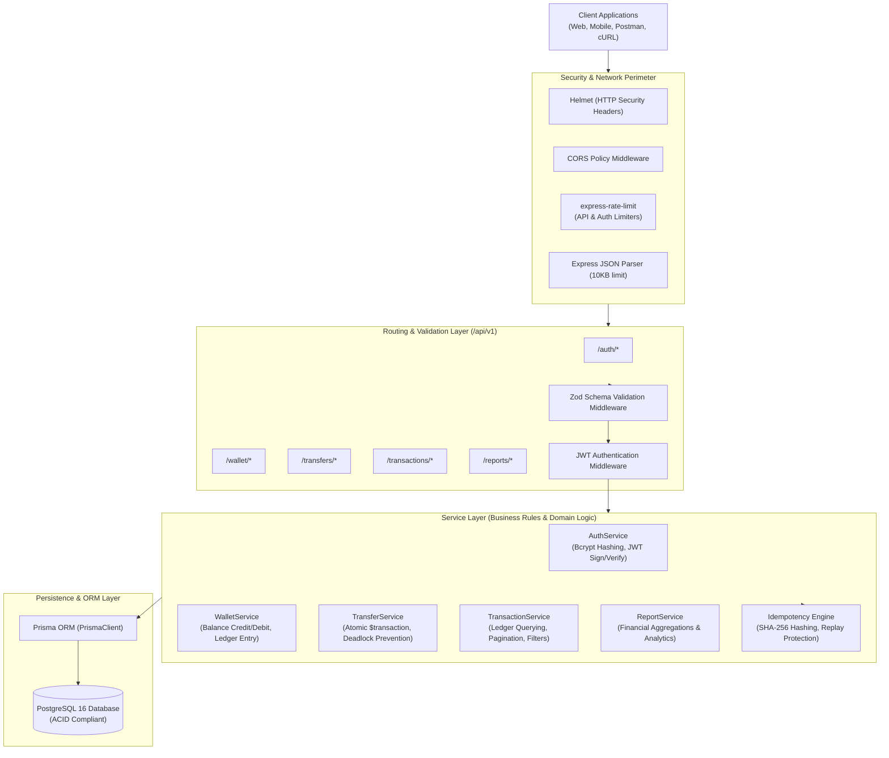
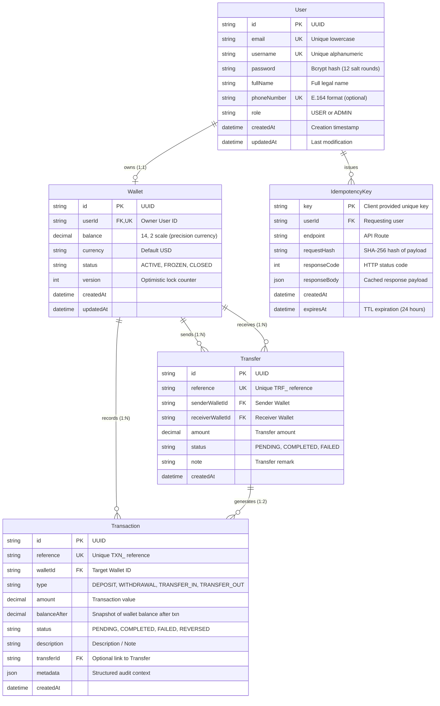
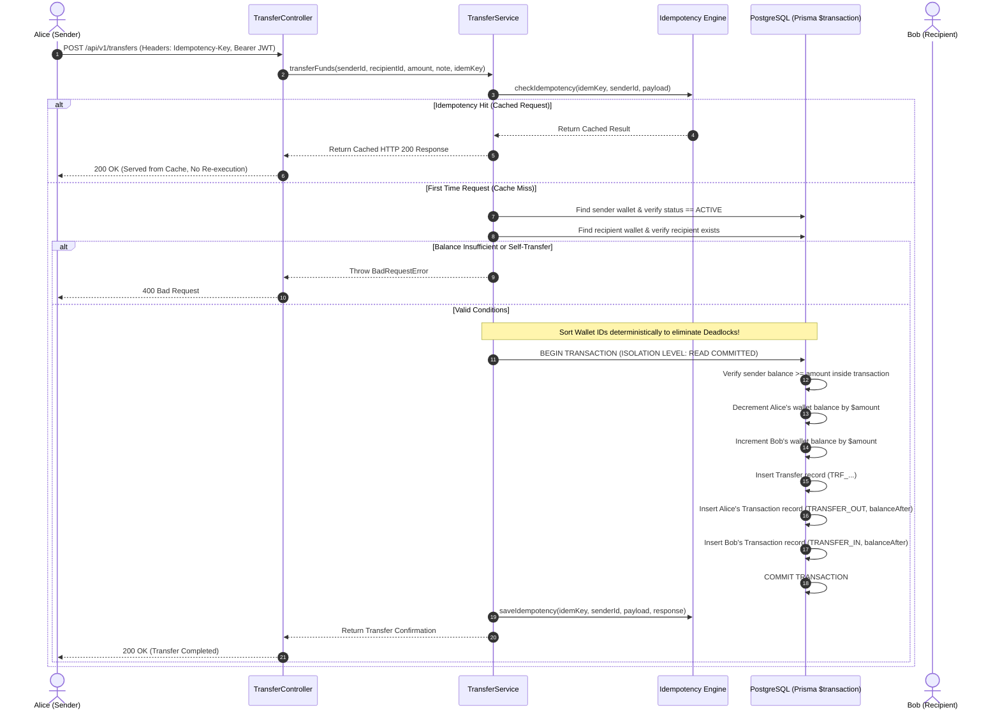

# SecurePay Architecture & System Design Documentation

This document provides a comprehensive technical overview of the architecture, database schema, transaction processing mechanics, and concurrency management designed for **SecurePay — Digital Wallet & Transaction Management API**.

---

## 1. System Architecture Overview

SecurePay is engineered following the **Modular Layered Architecture (Separation of Concerns)** pattern:



---

## 2. Database Schema (Entity-Relationship Diagram)

The database schema enforces data integrity through foreign keys, cascade deletes, unique constraints, and B-tree indexes.



---

## 3. Atomic Money Transfer & Double-Entry Ledger

In financial engineering, transfers must strictly adhere to **ACID** properties:
- **Atomicity:** Both sender debit and recipient credit succeed, or both fail.
- **Consistency:** The total sum of money in the system is invariant (no money is magically created or lost).
- **Isolation:** Concurrent transfers to/from the same wallet cannot see intermediate states or produce race conditions.
- **Durability:** Committed transactions survive system crashes.

### Sequence Diagram: Fund Transfer Execution



---

## 4. Concurrency & Deadlock Prevention Strategy

### The Mutual Deadlock Problem
Consider two users transferring money to each other at the exact same millisecond:
- **Thread 1:** User A transfers \$100 to User B. Thread 1 updates/locks Wallet A, then tries to update/lock Wallet B.
- **Thread 2:** User B transfers \$50 to User A. Thread 2 updates/locks Wallet B, then tries to update/lock Wallet A.

Without defensive ordering:
- Thread 1 holds lock on Wallet A, waiting for lock on Wallet B.
- Thread 2 holds lock on Wallet B, waiting for lock on Wallet A.
- **Result:** Classical Cyclic Deadlock! PostgreSQL detects the deadlock and aborts one transaction with error code `40P01`.

### The SecurePay Solution: Deterministic Resource Ordering
SecurePay orders database row updates **lexicographically by Primary Key (Wallet UUID)**:

```javascript
// Deterministic resource sequencing prevents cyclic dependency locks
const firstWalletId = senderWallet.id < recipientWallet.id ? senderWallet.id : recipientWallet.id;
const isSenderFirst = firstWalletId === senderWallet.id;

if (isSenderFirst) {
  await tx.wallet.update({ where: { id: senderWallet.id }, data: { balance: { decrement: amount } } });
  await tx.wallet.update({ where: { id: recipientWallet.id }, data: { balance: { increment: amount } } });
} else {
  await tx.wallet.update({ where: { id: recipientWallet.id }, data: { balance: { increment: amount } } });
  await tx.wallet.update({ where: { id: senderWallet.id }, data: { balance: { decrement: amount } } });
}
```

Because both concurrent transactions acquire row locks in identical chronological order (`Wallet_A` before `Wallet_B`), a cyclic lock cycle is mathematically impossible. One thread cleanly awaits the other and completes without deadlocking.

---

## 5. Security & Defense-in-Depth Mechanisms

| Defense Layer | Mechanism | Vulnerability Mitigated |
|---|---|---|
| **Header Hardening** | `helmet()` | XSS, Clickjacking, MIME sniffing, HSTS enforcement |
| **Origin Isolation** | `cors()` | Cross-Origin resource theft |
| **Rate Limiting** | `express-rate-limit` | Brute force login, Credential stuffing, DoS |
| **Input Validation** | `zod` schemas | SQL Injection, prototype pollution, parameter tampering |
| **Password Hashing** | `bcryptjs` (12 rounds) | Rainbow tables, dictionary attacks, database breach exposure |
| **Session Control** | Stateless JWT (Bearer tokens) | Broken object level authorization, session fixation |
| **Ledger Consistency** | Double-Entry with `balanceAfter` | Audit tampering, phantom balances, race conditions |
| **Idempotency** | SHA-256 request payload hashing | Double debit on client network retries / disconnects |
